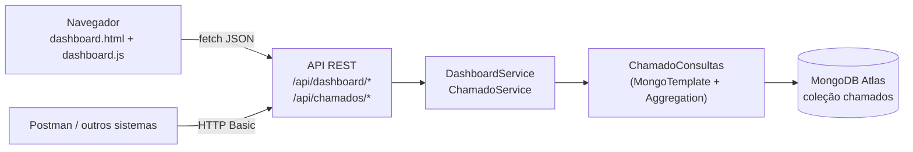
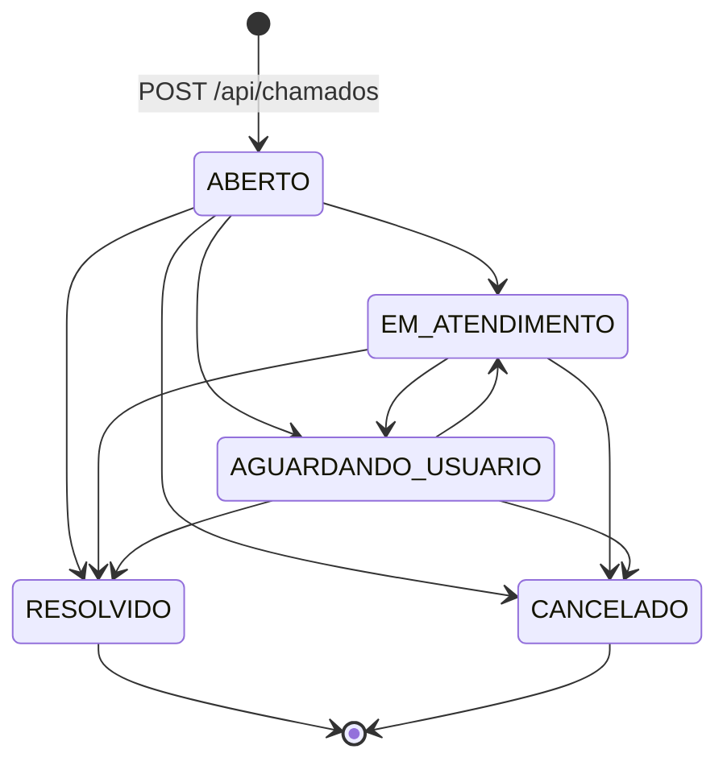
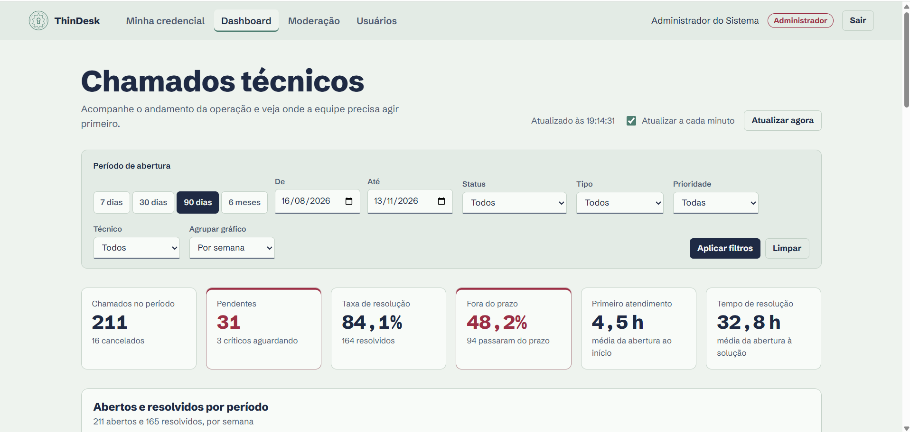
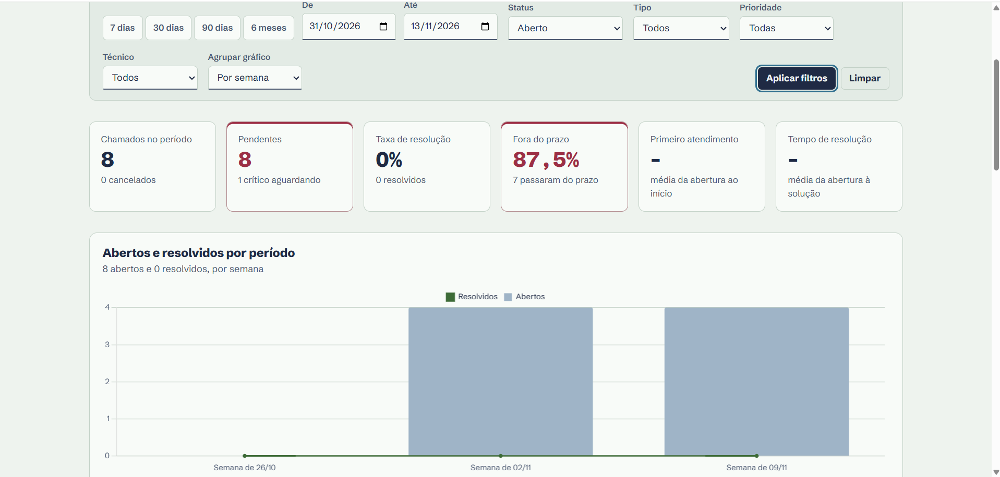
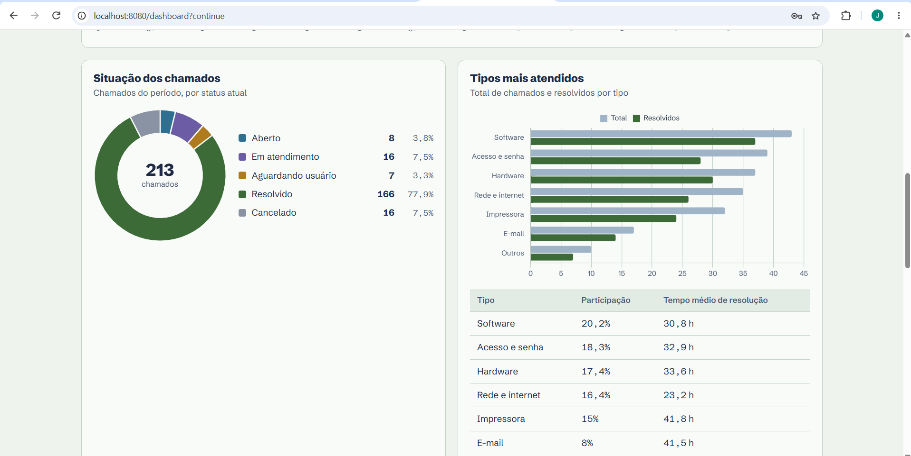
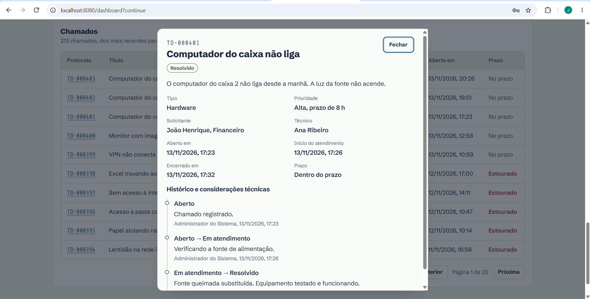
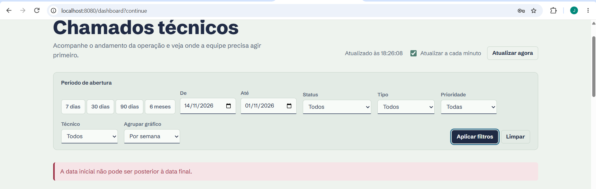
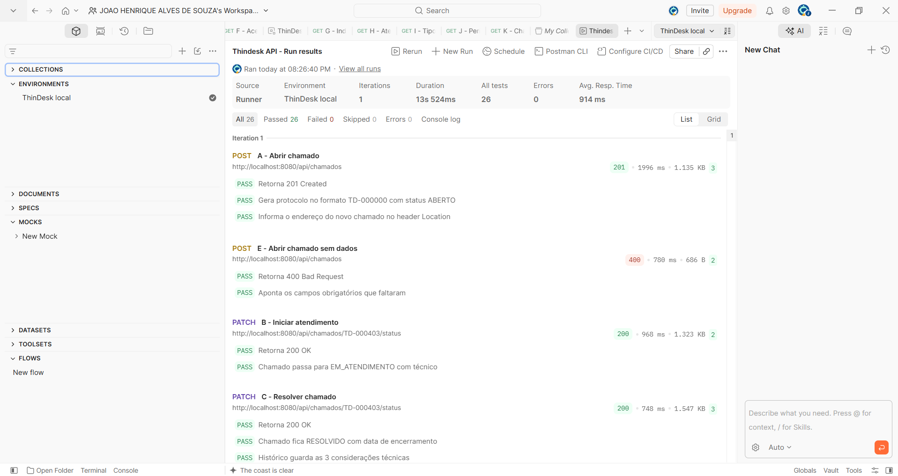

# Thindesk: Dashboard Administrativo de Chamados

| | |
|---|---|
| **Aluno** | João Henrique Alves de Souza |
| **Curso / turma** | Sistemas de Informação, SI 8B (UMC) |
| **Disciplina** | Aplicativos Web, Prof. Alessandro Horas |
| **Entrega** | 14/11/2026 |
| **Repositório** | https://github.com/JoaoHen29/login_seguro |

## Sumário

1. [Visão geral](#1-visão-geral)
2. [Análise: do modelo do Thindesk ao modelo do dashboard](#2-análise-do-modelo-do-thindesk-ao-modelo-do-dashboard)
3. [Requisitos funcionais](#3-requisitos-funcionais)
4. [Requisitos não funcionais](#4-requisitos-não-funcionais)
5. [Modelo de dados e regras de negócio](#5-modelo-de-dados-e-regras-de-negócio)
6. [Documentação da API](#6-documentação-da-api)
7. [Dashboard administrativo](#7-dashboard-administrativo)
8. [Evidências de testes](#8-evidências-de-testes)
9. [Principais decisões de projeto](#9-principais-decisões-de-projeto)
10. [Gitflow](#10-gitflow)

---

## 1. Visão geral

O Thindesk é o sistema de suporte técnico usado na disciplina. Este projeto acrescenta a ele um **dashboard administrativo**: um painel em que o responsável pelos chamados acompanha o andamento da operação, vê a situação e as considerações técnicas de cada chamado e identifica onde a equipe precisa agir.

O painel não lê o banco diretamente. Todos os números, gráficos e listas vêm de uma **API REST projetada e implementada neste projeto**, que consulta o MongoDB Atlas.

| Camada | Tecnologia |
|---|---|
| Back-end | Java 21, Spring Boot 4.1, Spring Web, Spring Security 7 |
| Banco de dados | MongoDB Atlas (Spring Data MongoDB, consultas com Aggregation) |
| Telas | Thymeleaf, HTML, CSS e JavaScript sem framework |
| Gráficos | Chart.js 4.4 (arquivo local) |
| Testes da API | Postman (coleção em [`postman/`](../postman/thindesk-api.postman_collection.json)) |

O projeto reaproveita o módulo de autenticação da atividade anterior (login, perfis ADMIN, MODERADOR e USUARIO, sessões no MongoDB). Instruções para configurar e executar estão no [README](../README.md).



---

## 2. Análise: do modelo do Thindesk ao modelo do dashboard

O ponto de partida foi o `Chamado` do Thindesk disponibilizado na disciplina, que tem cinco campos de texto: `descricao`, `status`, `tipo`, `tecnico` e `usuario`. Ao cruzar esse modelo com os requisitos do dashboard, apareceram lacunas:

- **Não há datas.** Sem a data de abertura e de encerramento é impossível montar a análise por período (RF02), calcular tempo de atendimento ou saber se um chamado passou do prazo.
- **Status e tipo são texto livre.** "Aberto", "aberto" e "Em aberto" seriam contados como situações diferentes, o que quebra a contagem por situação (RF03) e o ranking de tipos (RF04).
- **Não há prioridade**, então não há como medir prazo nem destacar chamados críticos.
- **Não há registro das considerações técnicas.** O enunciado pede que o responsável visualize as considerações técnicas, mas o modelo só guarda o estado atual.

Por isso o modelo foi **ampliado, mantendo os dados que o Thindesk já tinha**, e a API seguiu a mesma rota base `/api/chamados` e a mesma coleção `chamados`.

| Thindesk (disciplina) | Este projeto | Motivo |
|---|---|---|
| `descricao` | `descricao` + `titulo` | mesmo dado; o título curto é usado nas listas |
| `status` (texto livre) | `status` (lista fixa) | permite contar por situação de forma confiável (RF03) |
| `tipo` (texto livre) | `tipo` (lista fixa) | permite o ranking de tipos (RF04) |
| `tecnico` | `tecnicoResponsavel` | mesmo dado; filtro por técnico (RF05) |
| `usuario` | `solicitante` + `setor` | mesmo dado, com o setor de quem pediu |
| (não existia) | `protocolo` (TD-000001) | identificação legível do chamado |
| (não existia) | `prioridade` | prazo de atendimento e destaque dos críticos |
| (não existia) | `abertoEm`, `inicioAtendimentoEm`, `encerradoEm`, `atualizadoEm` | análise por período (RF02) e tempos médios (RF01) |
| (não existia) | `historico` | considerações técnicas de cada mudança de status |

---

## 3. Requisitos funcionais

| Código | Requisito | Como foi atendido | Endpoint |
|---|---|---|---|
| **RF01** | Indicadores gerais de chamados técnicos | Seis indicadores no topo do painel: chamados no período, pendentes (com críticos aguardando), taxa de resolução, percentual fora do prazo, tempo médio até o primeiro atendimento e tempo médio de resolução. Os cartões de pendentes e de prazo ficam em destaque quando há críticos aguardando ou mais de 25% fora do prazo. | `GET /api/dashboard/indicadores` |
| **RF02** | Análise de chamados atendidos por período (gráficos) | Gráfico de barras (abertos) com linha (resolvidos), agrupado por dia, semana ou mês. Períodos sem chamados aparecem com zero, para o gráfico não "pular" datas. | `GET /api/dashboard/atendimentos-por-periodo` |
| **RF03** | Situação dos chamados | Gráfico de rosca com o total e o percentual de cada status, a fila dos cinco pendentes há mais tempo e a janela de detalhe com o **histórico de considerações técnicas** de cada chamado. | `GET /api/dashboard/situacao` e `GET /api/chamados/{protocolo}` |
| **RF04** | Tipos de chamados mais atendidos | Gráfico de barras horizontais (total e resolvidos por tipo) e tabela com a participação e o tempo médio de resolução de cada tipo, do mais atendido para o menos atendido. | `GET /api/dashboard/tipos-mais-atendidos` |
| **RF05** | Filtros de consulta | Período (com atalhos de 7, 30, 90 dias e 6 meses), status, tipo, prioridade, técnico e agrupamento do gráfico. O mesmo filtro vale para todos os indicadores, gráficos e para a tabela. As opções das listas vêm da API. | `GET /api/dashboard/filtros` (opções) e parâmetros comuns |
| **RF06** | Integração com a API | O painel é uma página que busca tudo na API com `fetch`, quatro chamadas em paralelo (`Promise.all`). A mesma API atende o Postman ou qualquer outro sistema, com autenticação HTTP Basic. | Todos |
| **RF07** | Atualização e tratamento de dados | Atualização automática a cada 60 segundos (pausa quando a aba fica oculta), botão "Atualizar agora" e horário da última atualização. Erros da API são exibidos com a mensagem dela; sessão expirada mostra link para entrar de novo; servidor fora do ar gera aviso próprio; filtro sem resultado mostra mensagem. Números, datas e tempos são formatados no padrão brasileiro e no fuso de Brasília. | Todos |

Além dos sete requisitos, a API permite **abrir chamados e mudar o status** registrando a consideração técnica, o que alimenta o histórico mostrado no painel.

---

## 4. Requisitos não funcionais

| Código | Requisito | Como foi atendido |
|---|---|---|
| **RNF01** | Segurança de acesso | A API e o dashboard são restritos aos perfis ADMIN e MODERADOR. Sem credenciais a API responde 401; com o perfil USUARIO responde 403. No navegador vale a sessão do login; em outros clientes, HTTP Basic. |
| **RNF02** | Proteção contra XSS | O JavaScript nunca monta HTML com texto vindo da API: usa `textContent`. Um título como `<script>` aparece como texto e não é executado. |
| **RNF03** | Política de conteúdo (CSP) | O cabeçalho `Content-Security-Policy: default-src 'self'` impede scripts de outros domínios. Por isso o Chart.js é servido pela própria aplicação e não há script embutido no HTML. |
| **RNF04** | Credenciais fora do código | A string de conexão do Atlas e as senhas vêm de variáveis de ambiente ou de um `.env` ignorado pelo Git. A coleção do Postman usa variáveis de ambiente, sem senhas. |
| **RNF05** | Desempenho | Contagens e médias são feitas no próprio MongoDB com Aggregation (`$group`, `$count`, `$avg`), e não trazendo todos os documentos para o Java. Os campos usados em filtros têm índice. A listagem é paginada (até 100 itens por página). |
| **RNF06** | Respostas de erro padronizadas | Todo erro da API tem o mesmo formato JSON (`dataHora`, `status`, `erro`, `mensagem`, `caminho`, `campos`), com mensagens em português. Erros inesperados (500) não expõem detalhes internos e são registrados no log. |
| **RNF07** | Consistência de datas | Datas gravadas em UTC; filtros e agrupamentos calculados no fuso `America/Sao_Paulo`, para que "hoje" e "esta semana" sejam os do usuário. |
| **RNF08** | Usabilidade e acessibilidade | Layout responsivo (uma coluna em telas menores que 900 px), gráficos com descrição para leitores de tela, cores do tema claro e escuro lidas das variáveis CSS e respeito à preferência de reduzir animações. |
| **RNF09** | Manutenibilidade | Camadas separadas: controllers da API (`api`), regras (`chamado`, `dashboard`) e consultas (`ChamadoConsultas`). Formato de resposta definido em `records` Java. |
| **RNF10** | Dados de demonstração reproduzíveis | Na primeira execução, se a coleção estiver vazia, são gerados 400 chamados dos últimos 180 dias, com semente fixa, para o painel ter dados realistas. Controlado por `app.chamados.gerar-exemplos`. |

---

## 5. Modelo de dados e regras de negócio

### Documento da coleção `chamados`

```json
{
  "_id": "6735f2c1a9e4b52d1c0f4a11",
  "protocolo": "TD-000401",
  "titulo": "Computador do caixa não liga",
  "descricao": "O computador do caixa 2 não liga desde a manhã. A luz da fonte não acende.",
  "tipo": "HARDWARE",
  "prioridade": "ALTA",
  "status": "RESOLVIDO",
  "solicitante": "João Henrique",
  "setor": "Financeiro",
  "tecnicoResponsavel": "Ana Ribeiro",
  "abertoEm": "2026-11-13T20:23:28.454Z",
  "inicioAtendimentoEm": "2026-11-13T20:26:32.334Z",
  "encerradoEm": "2026-11-13T20:32:51.162Z",
  "atualizadoEm": "2026-11-13T20:32:51.162Z",
  "historico": [
    { "data": "2026-11-13T20:23:28.454Z", "autor": "Administrador do Sistema", "statusAnterior": null, "statusNovo": "ABERTO", "consideracao": "Chamado registrado." },
    { "data": "2026-11-13T20:26:32.334Z", "autor": "Administrador do Sistema", "statusAnterior": "ABERTO", "statusNovo": "EM_ATENDIMENTO", "consideracao": "Verificando a fonte de alimentação." },
    { "data": "2026-11-13T20:32:51.162Z", "autor": "Administrador do Sistema", "statusAnterior": "EM_ATENDIMENTO", "statusNovo": "RESOLVIDO", "consideracao": "Fonte queimada substituída. Equipamento testado e funcionando." }
  ]
}
```

Índices: `protocolo` (único), `tipo`, `prioridade`, `status`, `tecnicoResponsavel`, `abertoEm` e `encerradoEm`.

### Valores fixos

| Status | Descrição | Encerrado? |
|---|---|---|
| `ABERTO` | Aberto | não |
| `EM_ATENDIMENTO` | Em atendimento | não |
| `AGUARDANDO_USUARIO` | Aguardando usuário | não |
| `RESOLVIDO` | Resolvido | sim |
| `CANCELADO` | Cancelado | sim |

| Tipo | Descrição |
|---|---|
| `HARDWARE` | Hardware |
| `SOFTWARE` | Software |
| `REDE` | Rede e internet |
| `ACESSO` | Acesso e senha |
| `IMPRESSORA` | Impressora |
| `EMAIL` | E-mail |
| `OUTROS` | Outros |

| Prioridade | Prazo para resolver |
|---|---|
| `BAIXA` | 72 horas |
| `MEDIA` | 24 horas |
| `ALTA` | 8 horas |
| `CRITICA` | 4 horas |

### Regras de cálculo dos indicadores

- **Período:** um chamado pertence ao período pela data de **abertura**. Na série por período, os resolvidos são contados pela data de **encerramento**.
- **Atendido** = chamado com status `RESOLVIDO`.
- **Pendentes** = chamados ainda não encerrados (Aberto, Em atendimento, Aguardando usuário).
- **Taxa de resolução** = resolvidos ÷ (total − cancelados). Cancelados ficam fora, porque não foram atendidos nem deixaram de ser.
- **Fora do prazo** = chamados não cancelados cujo tempo desde a abertura (até o encerramento, ou até agora se ainda estiverem abertos) passou do prazo da prioridade. O percentual usa a mesma base da taxa de resolução.
- **Primeiro atendimento** = média do tempo entre a abertura e o início do atendimento.
- **Tempo de resolução** = média do tempo entre a abertura e o encerramento, só dos resolvidos.

### Regras para mudar o status



1. Toda mudança exige uma **consideração técnica**, que entra no histórico com o autor (usuário logado) e a data.
2. Chamado **resolvido ou cancelado não muda mais**.
3. O novo status precisa ser diferente do atual.
4. Um chamado em andamento **não volta para Aberto**.
5. Para iniciar ou resolver o atendimento é preciso um **técnico responsável**; para cancelar, não.
6. A primeira mudança (exceto cancelamento) grava o início do atendimento; resolver ou cancelar grava o encerramento.

Quebrar qualquer uma dessas regras gera **422**.

---

## 6. Documentação da API

### Informações gerais

| Item | Valor |
|---|---|
| URL base | `http://localhost:8080/api` |
| Formato | JSON (UTF-8) |
| Autenticação | HTTP Basic (e-mail e senha) ou a sessão do navegador após o login |
| Perfis permitidos | ADMIN e MODERADOR |
| Datas na resposta | ISO 8601 em UTC (`2026-11-13T20:23:28.454Z`) |
| Datas nos filtros | `AAAA-MM-DD`, interpretadas no fuso de Brasília |

Exemplo com `curl` (troque `SENHA` pela senha da conta):

```bash
curl -u admin@loginseguro.dev:SENHA "http://localhost:8080/api/dashboard/indicadores?inicio=2026-08-16&fim=2026-11-13"
```

Os valores dos exemplos abaixo são ilustrativos, gerados com a base de demonstração. As respostas reais estão nas [evidências](#8-evidências-de-testes).

### Parâmetros de filtro comuns

Aceitos por todos os endpoints de `/api/dashboard` (exceto `/filtros`) e por `GET /api/chamados`. Todos são opcionais.

| Parâmetro | Tipo | Exemplo | Descrição |
|---|---|---|---|
| `inicio` | data | `2026-08-16` | Primeiro dia do período (pela data de abertura) |
| `fim` | data | `2026-11-13` | Último dia do período, incluído |
| `status` | texto | `EM_ATENDIMENTO` | Um dos status da seção 5 |
| `tipo` | texto | `REDE` | Um dos tipos da seção 5 |
| `prioridade` | texto | `CRITICA` | Uma das prioridades da seção 5 |
| `tecnico` | texto | `Ana Ribeiro` | Nome exato do técnico responsável |

### Formato dos erros

Todos os erros têm o mesmo formato. `campos` só é preenchido quando o erro é de validação.

```json
{
  "dataHora": "2026-11-13T19:18:22.233210300Z",
  "status": 400,
  "erro": "Bad Request",
  "mensagem": "A data inicial não pode ser posterior à data final.",
  "caminho": "/api/dashboard/indicadores",
  "campos": {}
}
```

| Status | Quando acontece | Exemplo de mensagem |
|---|---|---|
| **400** Bad Request | Filtro, parâmetro ou corpo inválido | "A data inicial não pode ser posterior à data final." |
| **401** Unauthorized | Sem credenciais ou credenciais erradas | "Autenticação necessária. Envie e-mail e senha de um usuário ADMIN ou MODERADOR." |
| **403** Forbidden | Usuário autenticado com perfil USUARIO | "Seu perfil não tem acesso à API. Ela é restrita a ADMIN e MODERADOR." |
| **404** Not Found | Protocolo inexistente | "Chamado TD-999999 não encontrado." |
| **422** Unprocessable Content | Regra de negócio violada | "O chamado TD-000401 já está resolvido e não pode mais ser alterado." |
| **500** Internal Server Error | Falha inesperada (ex.: banco fora do ar) | "Erro interno ao processar a requisição. Tente novamente em instantes." |

### Resumo dos endpoints

| Método | Rota | Finalidade | Requisito |
|---|---|---|---|
| GET | `/api/dashboard/indicadores` | Indicadores gerais | RF01 |
| GET | `/api/dashboard/atendimentos-por-periodo` | Abertos e resolvidos por dia, semana ou mês | RF02 |
| GET | `/api/dashboard/situacao` | Totais por status e pendentes mais antigos | RF03 |
| GET | `/api/dashboard/tipos-mais-atendidos` | Ranking de tipos | RF04 |
| GET | `/api/dashboard/filtros` | Opções para montar os filtros | RF05 |
| GET | `/api/chamados` | Lista paginada de chamados | RF03, RF05 |
| GET | `/api/chamados/{protocolo}` | Detalhe com histórico de considerações | RF03 |
| POST | `/api/chamados` | Abre um chamado | RF07 |
| PATCH | `/api/chamados/{protocolo}/status` | Muda o status com consideração técnica | RF07 |

---

### GET `/api/dashboard/indicadores`

Indicadores gerais do período e dos filtros informados.

**Parâmetros:** filtros comuns.

**Requisição**
```http
GET /api/dashboard/indicadores?inicio=2026-08-16&fim=2026-11-13
```

**Resposta 200**
```json
{
  "totalChamados": 400,
  "pendentes": 41,
  "resolvidos": 328,
  "cancelados": 31,
  "criticosPendentes": 3,
  "foraDoPrazo": 177,
  "percentualForaDoPrazo": 48,
  "taxaResolucao": 88.9,
  "tempoMedioPrimeiroAtendimentoHoras": 4.3,
  "tempoMedioResolucaoHoras": 32.6,
  "geradoEm": "2026-11-13T19:17:04.574016500Z"
}
```

| Campo | Significado |
|---|---|
| `totalChamados` | Chamados abertos no período |
| `pendentes` / `criticosPendentes` | Não encerrados / desses, os de prioridade crítica |
| `resolvidos` / `cancelados` | Por status atual |
| `foraDoPrazo` / `percentualForaDoPrazo` | Passaram do prazo da prioridade (cancelados não entram) |
| `taxaResolucao` | Resolvidos ÷ (total − cancelados), em % |
| `tempoMedioPrimeiroAtendimentoHoras` | Média da abertura ao início do atendimento; `null` se não houver |
| `tempoMedioResolucaoHoras` | Média da abertura à solução; `null` se não houver |
| `geradoEm` | Momento do cálculo |

**Erros:** 400 (datas invertidas ou valor inválido em `status`, `tipo`, `prioridade`), 401, 403.

---

### GET `/api/dashboard/atendimentos-por-periodo`

Série temporal de chamados abertos e resolvidos, usada no gráfico do RF02.

**Parâmetros:** filtros comuns e:

| Parâmetro | Valores | Padrão | Período máximo |
|---|---|---|---|
| `agrupamento` | `DIA`, `SEMANA` ou `MES` | `DIA` | 93, 371 ou 1100 dias |

Sem `inicio` e `fim`, usa os últimos 30 dias. Semanas seguem a ISO 8601 (começam na segunda-feira).

**Requisição**
```http
GET /api/dashboard/atendimentos-por-periodo?inicio=2026-08-01&fim=2026-11-13&agrupamento=SEMANA
```

**Resposta 200** (resumida)
```json
{
  "agrupamento": "SEMANA",
  "inicio": "2026-08-01",
  "fim": "2026-11-13",
  "totalAbertos": 241,
  "totalResolvidos": 189,
  "pontos": [
    { "periodo": "2026-W31", "rotulo": "Semana de 27/07", "abertos": 0, "resolvidos": 1 },
    { "periodo": "2026-W32", "rotulo": "Semana de 03/08", "abertos": 12, "resolvidos": 9 },
    { "periodo": "2026-W33", "rotulo": "Semana de 10/08", "abertos": 19, "resolvidos": 15 }
  ]
}
```

**Erros**

| Status | Exemplo |
|---|---|
| 400 | `?agrupamento=ANO` → "Valor inválido para o parâmetro 'agrupamento': 'ANO'." |
| 400 | 200 dias com `DIA` → "Período longo demais para o agrupamento DIA: o máximo é 93 dias. Use um agrupamento maior." |
| 400 | Datas invertidas |
| 401 / 403 | Autenticação e perfil |

---

### GET `/api/dashboard/situacao`

Distribuição dos chamados do período pelo status atual e os cinco pendentes abertos há mais tempo.

**Parâmetros:** filtros comuns.

**Resposta 200** (resumida)
```json
{
  "total": 400,
  "porStatus": [
    { "status": "ABERTO", "descricao": "Aberto", "total": 14, "percentual": 3.5 },
    { "status": "EM_ATENDIMENTO", "descricao": "Em atendimento", "total": 19, "percentual": 4.8 },
    { "status": "AGUARDANDO_USUARIO", "descricao": "Aguardando usuário", "total": 8, "percentual": 2.0 },
    { "status": "RESOLVIDO", "descricao": "Resolvido", "total": 328, "percentual": 82.0 },
    { "status": "CANCELADO", "descricao": "Cancelado", "total": 31, "percentual": 7.8 }
  ],
  "pendentesMaisAntigos": [
    {
      "id": "6735f2c1a9e4b52d1c0f3b02",
      "protocolo": "TD-000352",
      "titulo": "Sem acesso à pasta compartilhada",
      "tipo": "ACESSO", "tipoDescricao": "Acesso e senha",
      "prioridade": "MEDIA", "prioridadeDescricao": "Média",
      "status": "AGUARDANDO_USUARIO", "statusDescricao": "Aguardando usuário",
      "solicitante": "Marina Lopes", "setor": "Comercial",
      "tecnicoResponsavel": "Bruno Carvalho",
      "abertoEm": "2026-10-28T13:12:00Z",
      "encerradoEm": null,
      "prazoEstourado": true
    }
  ]
}
```

Os cinco status sempre aparecem, mesmo com total zero, para o gráfico manter as mesmas cores e posições.

**Erros:** 400, 401, 403.

---

### GET `/api/dashboard/tipos-mais-atendidos`

Ranking dos tipos de chamado, do mais atendido para o menos atendido.

**Parâmetros:** filtros comuns e:

| Parâmetro | Valores | Padrão |
|---|---|---|
| `limite` | 1 a 7 | 5 |

**Resposta 200** (resumida)
```json
[
  { "tipo": "SOFTWARE", "descricao": "Software", "total": 96, "resolvidos": 80, "tempoMedioResolucaoHoras": 29.4, "percentual": 24.0 },
  { "tipo": "ACESSO", "descricao": "Acesso e senha", "total": 78, "resolvidos": 66, "tempoMedioResolucaoHoras": 12.1, "percentual": 19.5 },
  { "tipo": "HARDWARE", "descricao": "Hardware", "total": 64, "resolvidos": 51, "tempoMedioResolucaoHoras": 41.7, "percentual": 16.0 }
]
```

`percentual` é a participação do tipo no total do período; `tempoMedioResolucaoHoras` considera só os resolvidos.

**Erros:** 400 (`limite` fora de 1 a 7 → "O limite deve estar entre 1 e 7."), 401, 403.

---

### GET `/api/dashboard/filtros`

Opções para montar as listas de filtro do painel. Não recebe parâmetros.

**Resposta 200** (resumida)
```json
{
  "status": [ { "codigo": "ABERTO", "descricao": "Aberto" }, { "codigo": "EM_ATENDIMENTO", "descricao": "Em atendimento" } ],
  "tipos": [ { "codigo": "HARDWARE", "descricao": "Hardware" }, { "codigo": "REDE", "descricao": "Rede e internet" } ],
  "prioridades": [ { "codigo": "BAIXA", "descricao": "Baixa" }, { "codigo": "CRITICA", "descricao": "Crítica" } ],
  "tecnicos": [ "Ana Ribeiro", "Bruno Carvalho", "Carla Nogueira", "Diego Martins", "Elisa Prado" ],
  "agrupamentos": [ { "codigo": "DIA", "descricao": "Por dia" }, { "codigo": "SEMANA", "descricao": "Por semana" }, { "codigo": "MES", "descricao": "Por mês" } ],
  "primeiraData": "2026-05-18"
}
```

`tecnicos` vem do banco (técnicos que já atenderam). `primeiraData` é a abertura mais antiga, usada como limite do calendário.

**Erros:** 401, 403.

---

### GET `/api/chamados`

Lista paginada de chamados, do mais recente para o mais antigo.

**Parâmetros:** filtros comuns e:

| Parâmetro | Valores | Padrão |
|---|---|---|
| `pagina` | 0 ou mais | 0 |
| `tamanho` | 1 a 100 | 20 |

**Requisição**
```http
GET /api/chamados?tipo=HARDWARE&status=RESOLVIDO&pagina=0&tamanho=10
```

**Resposta 200** (resumida)
```json
{
  "itens": [
    {
      "id": "6735f2c1a9e4b52d1c0f4a11",
      "protocolo": "TD-000401",
      "titulo": "Computador do caixa não liga",
      "tipo": "HARDWARE", "tipoDescricao": "Hardware",
      "prioridade": "ALTA", "prioridadeDescricao": "Alta",
      "status": "RESOLVIDO", "statusDescricao": "Resolvido",
      "solicitante": "João Henrique", "setor": "Financeiro",
      "tecnicoResponsavel": "Ana Ribeiro",
      "abertoEm": "2026-11-13T20:23:28.454Z",
      "encerradoEm": "2026-11-13T20:32:51.162Z",
      "prazoEstourado": false
    }
  ],
  "pagina": 0,
  "tamanho": 10,
  "totalItens": 52,
  "totalPaginas": 6
}
```

**Erros:** 400 (`pagina` negativa ou `tamanho` fora de 1 a 100 → "Use pagina a partir de 0 e tamanho entre 1 e 100."; filtros inválidos), 401, 403.

---

### GET `/api/chamados/{protocolo}`

Detalhe de um chamado com o **histórico de considerações técnicas**. O protocolo não diferencia maiúsculas de minúsculas (`td-000401` funciona).

**Resposta 200** (resumida)
```json
{
  "chamado": { "protocolo": "TD-000401", "titulo": "Computador do caixa não liga", "status": "RESOLVIDO", "...": "mesmos campos da listagem" },
  "descricao": "O computador do caixa 2 não liga desde a manhã. A luz da fonte não acende.",
  "prazoHoras": 8,
  "inicioAtendimentoEm": "2026-11-13T20:26:32.334Z",
  "atualizadoEm": "2026-11-13T20:32:51.162Z",
  "historico": [
    { "autor": "Administrador do Sistema", "statusAnterior": null, "statusNovo": "ABERTO", "consideracao": "Chamado registrado.", "data": "2026-11-13T20:23:28.454Z" },
    { "autor": "Administrador do Sistema", "statusAnterior": "ABERTO", "statusNovo": "EM_ATENDIMENTO", "consideracao": "Verificando a fonte de alimentação.", "data": "2026-11-13T20:26:32.334Z" },
    { "autor": "Administrador do Sistema", "statusAnterior": "EM_ATENDIMENTO", "statusNovo": "RESOLVIDO", "consideracao": "Fonte queimada substituída. Equipamento testado e funcionando.", "data": "2026-11-13T20:32:51.162Z" }
  ]
}
```

**Erros:** 404 ("Chamado TD-999999 não encontrado."), 401, 403.

---

### POST `/api/chamados`

Abre um chamado. O protocolo é gerado em sequência (`TD-000001`, `TD-000002`...), o status começa em `ABERTO` e o histórico recebe a primeira consideração ("Chamado registrado.") com o nome de quem abriu.

**Corpo**

| Campo | Tipo | Obrigatório | Regra |
|---|---|---|---|
| `titulo` | texto | sim | até 120 caracteres |
| `descricao` | texto | sim | até 2000 caracteres |
| `tipo` | texto | sim | um dos tipos da seção 5 |
| `prioridade` | texto | sim | uma das prioridades da seção 5 |
| `solicitante` | texto | sim | até 80 caracteres |
| `setor` | texto | sim | até 60 caracteres |

**Requisição**
```http
POST /api/chamados
Content-Type: application/json

{
  "titulo": "Computador do caixa não liga",
  "descricao": "O computador do caixa 2 não liga desde a manhã. A luz da fonte não acende.",
  "tipo": "HARDWARE",
  "prioridade": "ALTA",
  "solicitante": "João Henrique",
  "setor": "Financeiro"
}
```

**Resposta 201 Created**, com o cabeçalho `Location: /api/chamados/TD-000401` e o corpo no mesmo formato do detalhe.

**Erros**

| Status | Exemplo |
|---|---|
| 400 | Corpo `{}` → "Há campos inválidos na requisição.", com `campos`: `{"titulo": "Informe o título.", "descricao": "Descreva o problema.", "tipo": "Informe o tipo do chamado.", "prioridade": "Informe a prioridade.", "solicitante": "Informe o solicitante.", "setor": "Informe o setor."}` |
| 400 | `"tipo": "TELEFONE"` ou JSON malformado → "Corpo da requisição inválido. Verifique o JSON e os valores dos campos." |
| 401 / 403 | Autenticação e perfil |

---

### PATCH `/api/chamados/{protocolo}/status`

Muda o status do chamado e registra a consideração técnica no histórico. O autor é o usuário autenticado.

**Corpo**

| Campo | Tipo | Obrigatório | Regra |
|---|---|---|---|
| `status` | texto | sim | novo status |
| `consideracao` | texto | sim | até 1000 caracteres |
| `tecnicoResponsavel` | texto | na primeira atribuição | até 80 caracteres; se omitido, mantém o atual |

**Requisição**
```http
PATCH /api/chamados/TD-000401/status
Content-Type: application/json

{
  "status": "EM_ATENDIMENTO",
  "consideracao": "Verificando a fonte de alimentação.",
  "tecnicoResponsavel": "Ana Ribeiro"
}
```

**Resposta 200**, no formato do detalhe, já com a nova entrada no `historico`.

**Erros**

| Status | Situação | Mensagem |
|---|---|---|
| 400 | Sem `consideracao` | campo `consideracao`: "Registre a consideração técnica da mudança." |
| 404 | Protocolo inexistente | "Chamado TD-999999 não encontrado." |
| 422 | Chamado encerrado | "O chamado TD-000401 já está resolvido e não pode mais ser alterado." |
| 422 | Mesmo status | "O chamado já está com o status Em atendimento." |
| 422 | Voltar para Aberto | "Um chamado em andamento não pode voltar para Aberto." |
| 422 | Sem técnico | "Informe o técnico responsável para iniciar o atendimento." |
| 401 / 403 | Autenticação e perfil | |

---

## 7. Dashboard administrativo

Acesso: entrar com uma conta ADMIN ou MODERADOR e clicar em **Dashboard** no menu (`/dashboard`). Para o perfil USUARIO o link não aparece e a rota devolve a página de acesso negado.

### Topo, filtros e indicadores (RF01, RF05, RF07)



- O painel abre com os **últimos 90 dias**, agrupados por semana.
- Os atalhos mudam o período e o agrupamento: até 31 dias o gráfico é por dia; acima disso, por semana.
- **Aplicar filtros** recarrega indicadores, gráficos, fila e tabela com os mesmos parâmetros. **Limpar** volta ao padrão.
- O horário "Atualizado às" e a caixa **Atualizar a cada minuto** mostram e controlam a atualização automática.

Filtrando só os chamados com status **Aberto** das duas últimas semanas, os indicadores e o gráfico mudam juntos:



### Gráficos, situação e tipos (RF02, RF03, RF04)



- **Abertos e resolvidos por período:** barras com os abertos e linha com os resolvidos, para comparar a entrada de chamados com a capacidade de resolução.
- **Situação dos chamados:** rosca com o total no centro e legenda com quantidade e percentual de cada status.
- **Pendentes há mais tempo:** os cinco chamados não encerrados mais antigos, com o tempo desde a abertura em vermelho quando o prazo já passou.
- **Tipos mais atendidos:** total e resolvidos por tipo, com tabela de participação e tempo médio de resolução.

### Detalhe e considerações técnicas (RF03)

Clicar em um protocolo, na fila ou na tabela, abre o detalhe do chamado com a linha do tempo das considerações técnicas: cada mudança de status, quem fez, quando e o que foi registrado.



### Tratamento de erros na tela (RF07)

Quando a API recusa um filtro, a mensagem dela aparece em destaque, sem quebrar o restante do painel:



---

## 8. Evidências de testes

### Testes automatizados no Postman

A coleção [`postman/thindesk-api.postman_collection.json`](../postman/thindesk-api.postman_collection.json) tem 11 requisições, cada uma com verificações automáticas (scripts *post-response*). O usuário e a senha ficam num ambiente local do Postman (`{{email}}`, `{{senha}}`, `{{baseUrl}}`), que não é exportado. A requisição A guarda o protocolo criado em `{{protocolo}}` para B, C e D usarem o mesmo chamado.

| # | Requisição | Esperado | O que é verificado | Testes |
|---|---|---|---|---|
| A | `POST /api/chamados` | 201 | protocolo `TD-000000`, status ABERTO, cabeçalho `Location` | 3 |
| E | `POST /api/chamados` com `{}` | 400 | campos obrigatórios apontados em `campos` | 2 |
| B | `PATCH .../status` → EM_ATENDIMENTO | 200 | status e técnico gravados | 2 |
| C | `PATCH .../status` → RESOLVIDO | 200 | encerramento gravado e 3 considerações no histórico | 3 |
| D | `PATCH .../status` no resolvido | 422 | mensagem de chamado encerrado | 2 |
| F | `GET /api/dashboard/indicadores` como USUARIO | 403 | mensagem de perfil sem acesso | 2 |
| G | `GET /api/dashboard/indicadores` | 200 | campos dos indicadores e total maior que zero | 2 |
| H | `GET .../atendimentos-por-periodo` por mês | 200 | agrupamento MES e soma dos pontos igual ao total | 3 |
| I | `GET .../tipos-mais-atendidos?limite=3` | 200 | no máximo 3 tipos, em ordem decrescente | 3 |
| J | `GET .../indicadores` com datas invertidas | 400 | mensagem sobre a data inicial | 2 |
| K | `GET /api/chamados/TD-999999` | 404 | mensagem com o protocolo | 2 |

**Resultado no Collection Runner: 26 testes, 26 aprovados, 0 falhas, 0 erros.**



Para repetir: importar a coleção no Postman, criar um ambiente com `baseUrl` (`http://localhost:8080`), `email`, `senha`, `emailUsuario` e `senhaUsuario`, selecionar o ambiente e usar **Run collection**.

### Testes manuais da API

| # | Cenário | Resultado | Evidência |
|---|---|---|---|
| 01 | Indicadores no navegador logado como admin | 200, 400 chamados da base de demonstração | [01-api-indicadores.png](evidencias/01-api-indicadores.png) |
| 02 | Série semanal de 01/08 a 13/11 | 200, semanas ISO com rótulos | [02-api-periodo-semanal.png](evidencias/02-api-periodo-semanal.png) |
| 03 | Protocolo inexistente | 404 no formato padrão | [03-api-erro-404.png](evidencias/03-api-erro-404.png) |
| 04 | Data inicial depois da final | 400 com mensagem clara | [04-api-erro-400-datas.png](evidencias/04-api-erro-400-datas.png) |
| 05 | Credenciais inválidas | 401 em JSON | [05-seguranca-401-credenciais-invalidas.png](evidencias/05-seguranca-401-credenciais-invalidas.png) |
| 06 | Perfil USUARIO | 403 em JSON | [06-seguranca-403-usuario.png](evidencias/06-seguranca-403-usuario.png) |
| 07 | Abrir chamado | 201 com histórico inicial | [07-postman-a-abrir-201.png](evidencias/07-postman-a-abrir-201.png) |
| 08 | Iniciar atendimento | 200 com nova consideração | [08-postman-b-iniciar-200.png](evidencias/08-postman-b-iniciar-200.png) |
| 09 | Resolver chamado | 200 com encerramento | [09-postman-c-resolver-200.png](evidencias/09-postman-c-resolver-200.png) |
| 10 | Abrir chamado sem dados | 400 com os campos | [10-postman-e-validacao-400.png](evidencias/10-postman-e-validacao-400.png) |

### Testes do dashboard

| # | Cenário | Resultado | Evidência |
|---|---|---|---|
| 12 | Abrir o painel como admin | indicadores, gráficos, fila e tabela carregados | [12-dashboard-indicadores.png](evidencias/12-dashboard-indicadores.png) |
| 13 | Filtrar por status Aberto | todos os blocos atualizados com o filtro | [13-dashboard-filtro-status.png](evidencias/13-dashboard-filtro-status.png) |
| 14 | Gráficos de situação e tipos | rosca, legenda, fila e ranking exibidos | [14-dashboard-graficos.png](evidencias/14-dashboard-graficos.png) |
| 15 | Clicar em um protocolo | detalhe com o histórico de considerações | [15-dashboard-detalhe-historico.png](evidencias/15-dashboard-detalhe-historico.png) |
| 16 | Datas invertidas no filtro | mensagem de erro da API exibida | [16-dashboard-erro-datas.png](evidencias/16-dashboard-erro-datas.png) |
| | Entrar como MODERADOR | painel funciona normalmente | teste manual |
| | Entrar como USUARIO | link não aparece; `/dashboard` mostra acesso negado | teste manual |

---

## 9. Principais decisões de projeto

| Decisão | Justificativa |
|---|---|
| Ampliar o modelo do Thindesk em vez de usá-lo como está | Sem datas, prioridade e histórico, os requisitos RF02, RF03 e parte do RF01 seriam impossíveis (seção 2). |
| Status, tipo e prioridade como listas fixas (`enum`) | Garante contagens corretas e permite validar a entrada na API. |
| Histórico de considerações dentro do próprio chamado | O histórico sempre é lido junto com o chamado; guardá-lo no mesmo documento evita uma segunda consulta e combina com o modelo de documentos do MongoDB. |
| Endpoints separados por bloco do painel | Cada bloco (indicadores, período, situação, tipos) tem uma resposta enxuta, que pode ser reaproveitada por outro sistema e testada isoladamente. O painel chama os quatro em paralelo. |
| Cálculos no banco com Aggregation | O MongoDB devolve só os totais e médias; o volume trafegado não cresce com o número de chamados. |
| Mesmos filtros para todos os endpoints | Um único objeto de filtro garante que indicadores, gráficos e tabela sempre mostrem o mesmo recorte. |
| Códigos HTTP específicos (400, 401, 403, 404, 422) | Quem consome a API distingue erro de digitação, falta de permissão, chamado inexistente e regra de negócio sem ler o texto da mensagem. |
| Dashboard em JavaScript puro com Chart.js local | Sem etapa de build, compatível com a CSP do projeto e leve para carregar. |
| Atualização automática a cada 60 s, pausada com a aba oculta | Mantém o painel atual sem gerar requisições quando ninguém está olhando. |
| Base de demonstração gerada com semente fixa | Gráficos realistas desde a primeira execução, sempre com os mesmos dados. |

---

## 10. Gitflow

| Branch | Conteúdo |
|---|---|
| `main` | Versões entregues: `v1.0.0` (login seguro) e `v2.0.0` (dashboard) |
| `develop` | Integração das funcionalidades |
| `feature/api-chamados` | Modelo de chamados, consultas e endpoints da API |
| `feature/dashboard` | Tela do dashboard, estilos e JavaScript |
| `feature/testes` | Coleção do Postman e evidências |
| `feature/documentacao` | Este documento e o vídeo |

Cada `feature/*` foi unida à `develop` com `--no-ff` e a versão final foi publicada na `main` por uma branch `release/v2.0.0`.

---

*Apoio de IA: o desenvolvimento contou com o auxílio do Claude (Anthropic) para orientação, revisão de código e redação da documentação. O uso de IA foi autorizado pelo professor.*
